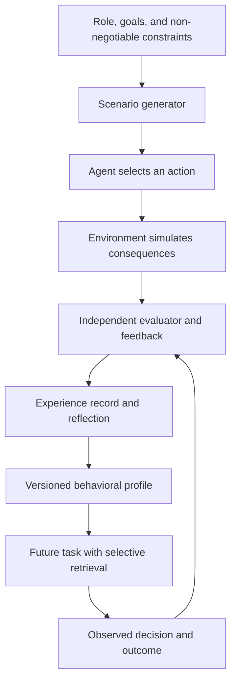

# Decision DNA

### Experience-conditioned decision-making for autonomous AI agents

**Status:** Research proposal and evaluation scaffold (v0.1). **No experimental performance claims are made.**

Decision DNA investigates a simple question:

> Can simulated professional decisions, their consequences, and structured reflection produce persistent, differentiated, and useful behavior in AI agents without changing the underlying foundation model?

Many agents receive a role prompt such as *"You are a helpful, confident sales representative."* This project asks whether a documented history of decisions and evaluated outcomes can provide a more robust behavioral identity than a static persona prompt.

It does **not** claim that an agent becomes conscious, obtains real-world work experience, or changes its model weights merely by answering questions through an API.

## Proposed mechanism



The working term **Decision DNA** refers to a versioned, inspectable behavioral profile, not a biological analogy or a neural network parameter vector. A profile might include preferred approaches to ambiguity, initiative, risk, escalation, honesty, and cooperation, supported by specific cases and evidence. Safety policies and delegated authority remain separate and take precedence.

## Research questions

1. **Utility:** Do agents conditioned on simulated, evaluated experience outperform agents using only a job prompt or static personality description on unseen tasks?
2. **Consistency:** Are decisions more stable across paraphrases, pressure, and context changes?
3. **Diversity:** Can distinct experience histories create useful differences between agents sharing the same base model without causing personality collapse?
4. **Portability:** Can a behavioral history remain useful after changing the underlying model?
5. **Cost:** Is any benefit large enough to justify simulation, storage, retrieval, and evaluation overhead?

## Experimental conditions

| Arm | Conditioning |
| --- | --- |
| A: Role baseline | Same base model and job instructions only |
| B: Static persona | A plus a detailed, fixed persona profile |
| C: Decision DNA | A plus simulated actions, evaluated consequences, distilled principles, and relevant retrieved experience |

Run all arms on held-out scenario families. Hold model version, tools, budget, and safety policy constant. Use deterministic checks where possible, independent human or blinded evaluators where needed, and report uncertainty. Do not let an LLM judge its own outputs without safeguards.

See [Research proposal](docs/research-proposal.md), [Technical architecture](docs/architecture.md), [Related work](docs/related-work.md), and [Experiment design](experiments/README.md).

## Minimal evaluation scaffold

The repository includes a **standard-library Python** scorer for manually specified example decisions. It is an interface and regression-test demonstration, not evidence that Decision DNA works.

```bash
python3 experiments/score.py \
  --scenarios experiments/fixtures/scenarios.jsonl \
  --decisions experiments/fixtures/example_decisions.jsonl
```

To run an actual experiment, replace example decisions with timestamped decisions from the three experimental arms; add a real scenario simulator, independent evaluator, and preregistered held-out scenarios. Preserve model/version, prompts, costs, and random seeds for reproducibility.

## What is not yet implemented

- A model adapter or LLM orchestration runtime
- Causal, independently validated consequence generation
- Automatic behavioral reflection or memory retrieval
- Fine-tuning or steering of neural activations
- Human-rated experiments or statistical comparisons
- Production integration with LifeMaster

These are explicit research milestones, not hidden features.

## Practical use and safety

This project is aimed at **role-conditioned professional agents**. It must not be used to fabricate credentials, imply genuine years of employment, or present synthetic experience as verified human experience. A simulated sales history cannot authorize discounts; a simulated healthcare history cannot authorize diagnosis. All external actions remain subject to real permissions, policies, audit trails, and human review where required.

Never place customer conversations, credentials, personal records, or production memories in public benchmark fixtures.

## Project origin

Concept developed for research around persistent AI employees in [LifeMaster](https://lifemaster.ai). The research proposition is independent of the LifeMaster production codebase.

## Prior art and novelty

Generative Agents, Concordia, SOTOPIA, HEART-Bench, and research on event-induced personality shifts already explore important parts of the problem. The proposed contribution is an **evaluated, professional-task-focused behavioral history** with explicit consequences, role constraints, portability, and controlled comparisons. Novelty is a hypothesis to establish, not a claim of priority. See [Related work](docs/related-work.md).

## Reuse

The repository is public for research review and discussion. A reuse license has not yet been selected; public visibility alone is not a general open-source license. Please seek permission before reusing the contents beyond permissions provided by GitHub's terms.

